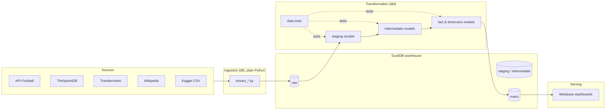

# Botola Pro Analytics

An end-to-end data platform for the **Moroccan Botola Pro** football league.

The project collects data from multiple public sources, loads it into a local
DuckDB warehouse, models it with dbt into a star schema, and exposes the result
through Metabase dashboards. The whole flow is orchestrated with Airflow.


---

## Overview

Football leagues generate a lot of fragmented data: fixtures and results live on
one API, historical tables on another, squad values on Transfermarkt, and title
history on Wikipedia. This project pulls those sources together into a single,
tested, analytics-ready warehouse that answers questions such as:

- Current league standings, form and points progression
- Top scorers and scoring efficiency (goals per 90)
- Match-level results reconciled across multiple sources
- Squad market value versus league position
- Historical champions and long-term dominance

The design follows a standard layered (medallion) approach: **raw → staging →
intermediate → marts**, with data-quality tests guarding every hop.

---

## Architecture



Airflow runs the extractors in parallel, then `dbt run`, then `dbt test`, then
`dbt docs generate` as a daily DAG.

---

## Tech stack

| Layer | Tool | Purpose |
|-------|------|---------|
| Ingestion | [dlt](https://dlthub.com/) | Python-based loads into DuckDB |
| Warehouse | [DuckDB](https://duckdb.org/) | Embedded analytical database (single file) |
| Transformation | [dbt-duckdb](https://github.com/duckdb/dbt-duckdb) | SQL models, tests and docs |
| Orchestration | [Apache Airflow](https://airflow.apache.org/) | Scheduling and task dependencies |
| Visualization | [Metabase](https://www.metabase.com/) | Dashboards on top of the marts |
| Packaging | Docker Compose | Local Airflow + Metabase stack |

---

## Data sources

| Source | Script | What it provides |
|--------|--------|------------------|
| API-Football | `extract_apifootball.py` | Current-season fixtures, standings, top scorers, teams |
| TheSportsDB | `extract_sportsdb.py` | Historical season results and team metadata |
| Transfermarkt | `extract_transfermarkt.py` | Squad and player market values (scraped) |
| Wikipedia | `extract_wikipedia.py` | Botola Pro champions by season |
| Kaggle CSV | `extract_kaggle.py` | Additional historical match results |

Each extractor is a standalone script that writes its own resources into the
`raw` schema of `warehouse/botola.duckdb`.

---

## Data model

The dbt project is organised into three layers:

**Staging** (`transform/models/staging`): one model per source, light typing
and column renaming:

- `stg_fixtures`, `stg_standings`, `stg_players`, `stg_player_stats`,
  `stg_market_values`, `stg_champions`

**Intermediate** (`transform/models/intermediate`): reusable business logic

- `int_matches`: unified, de-duplicated match results from every source
- `int_team_season_stats`: match results unpivoted to one row per team per match

**Marts** (`transform/models/marts`): the star schema consumed by BI

Dimensions
- `dim_teams`, `dim_players`, `dim_seasons`, `dim_dates`

Facts
- `fct_standings`: current league table
- `fct_matches`: match-level results
- `fct_top_scorers`: goals, assists and per-90 efficiency
- `fct_form_table`: last-5 form with a `WDL` string
- `fct_points_progression`: cumulative points per matchweek
- `fct_market_values`: squad value joined to league position
- `fct_champions_history`: titles per club by season

> dbt writes the models into the configured target schema, so the physical
> schemas in DuckDB are named `marts_staging`, `marts_intermediate` and
> `marts_marts`. `raw` holds the ingestion output.

---

## Data quality

Data quality is enforced with dbt tests:

- **Generic tests**: `unique`, `not_null`, `accepted_values` and
  `dbt_utils.accepted_range` across staging and marts columns.
- **A custom generic test**:
  `assert_sources_agree_on_result` fails the build if API-Football and
  TheSportsDB disagree on the outcome of the same match.

Run them with `dbt test`.

---

## Project structure

```
botola-bi/
├── data/                        # Local CSV used by the Kaggle extractor
├── ingestion/
│   ├── dags/
│   │   └── botola_pipeline.py   # Airflow DAG
│   ├── extract_apifootball.py
│   ├── extract_sportsdb.py
│   ├── extract_transfermarkt.py
│   ├── extract_wikipedia.py
│   └── extract_kaggle.py
├── transform/                   # dbt project
│   ├── models/
│   │   ├── staging/
│   │   ├── intermediate/
│   │   └── marts/{dims,fcts}/
│   ├── tests/generic/
│   ├── dbt_project.yml
│   └── profiles.yml
├── dashboard/                   # Metabase setup notes
├── warehouse/                   # DuckDB database (generated)
├── docker-compose.yml           # Airflow + Metabase
├── metabase.Dockerfile
├── requirements.txt
└── .env.example
```

---

## Getting started

### Prerequisites

- Python 3.11+
- Docker and Docker Compose (for Airflow and Metabase)
- An API-Football key (free tier is enough for the Botola Pro league)

### 1. Configure

```bash
cp .env.example .env
# then edit .env and set APIFOOTBALL_KEY
```

### 2. Install dependencies

```bash
python -m venv .venv
source .venv/bin/activate
pip install -r requirements.txt
```

### 3. Run the ingestion

```bash
python ingestion/extract_apifootball.py
python ingestion/extract_sportsdb.py
python ingestion/extract_transfermarkt.py
python ingestion/extract_wikipedia.py
python ingestion/extract_kaggle.py
```

Each script appends/replaces its resources in `warehouse/botola.duckdb`.

### 4. Build and test the models

```bash
cd transform
dbt deps
dbt run --profiles-dir .
dbt test --profiles-dir .
dbt docs generate --profiles-dir .
```

`dbt docs serve` opens the generated lineage and documentation site.

### 5. Run the full stack (optional)

```bash
docker compose up --build
```

- Airflow UI: http://localhost:8080 (DAG: `botola_bi_daily`, daily at 06:00)
- Metabase: http://localhost:3000

To point Metabase at the warehouse, add a DuckDB connection with the database
file at `/warehouse/botola.duckdb`.

---

## Scheduling

`ingestion/dags/botola_pipeline.py` defines the `botola_bi_daily` DAG:

1. Four extractors run in parallel.
2. `dbt run` builds the models.
3. `dbt test` validates the output.
4. `dbt docs generate` refreshes the documentation.

---

## Notes and limitations

- The DuckDB warehouse and any derived files are **not** committed; they are
  rebuilt by running the pipeline.
- The Transfermarkt scraper covers a subset of clubs and applies a polite delay
  between requests.
- Some historical metrics (e.g. season start/end years in `dim_seasons`) are
  intentionally left nullable while historical coverage is expanded.

---

## License

Released under the MIT License. Add a `LICENSE` file to make this official.
